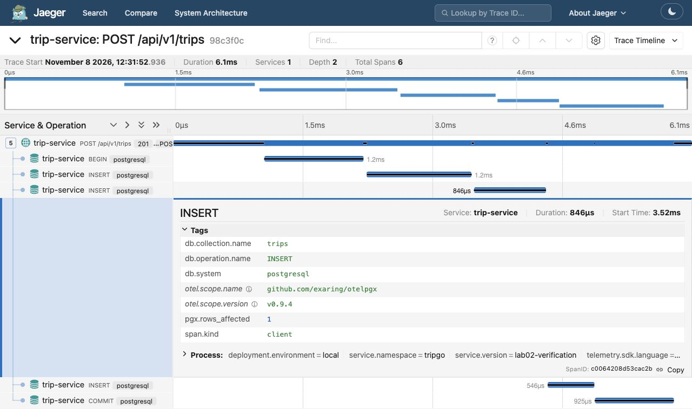
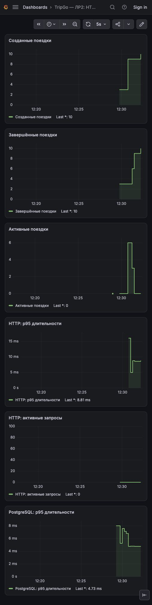

# Финальная проверка ЛР2

Проверено 8 ноября 2026 года на локальном окружении tripgo-lab-02.
Коммиты, push и создание PR агентом не выполнялись.

## Автоматические проверки

- `make build` — успешно.
- `make test` — успешно, с детектором гонок.
- `make test-integration` — успешно, PostgreSQL, два прогона с детектором гонок.
- `golangci-lint run ./...` — 0 замечаний.
- Повторная генерация OpenAPI и GoMock не изменила сгенерированные файлы.
- В зависимостях домена отсутствуют net/http, chi, pgx и OpenTelemetry.
- Контракты API и миграции в рамках ЛР2 не изменены.

Тесты проверяют HTTP-логи, шаблоны маршрутов, W3C TraceContext,
HTTP-метрики и панику с ответом 500. SQL-тесты проверяют имя и родителя
спана, атрибуты таблицы/операции/ошибки и отсутствие двойного счёта.
Метрики БД считаются также при отключённом сэмплировании.
Бизнес-счётчики проверены на успех, ошибку COMMIT и идемпотентные повторы.
Gauge проверен на актуальное значение, ошибку источника и снятие callback.

## HTTP и отказ коллектора

Контрольная последовательность:

1. Создание новой поездки — 201.
2. Повтор с тем же ключом и телом — 200, тот же ID.
3. Создание без ключа для занятого водителя — 409.
4. Изменённое тело с прежним ключом — 409.
5. Получение поездки — 200.
6. Завершение — 200.
7. Повтор завершения — 409.

Последовательность выполнена при работающем коллекторе, затем при
масштабировании только deployment otel-collector до 0.
PostgreSQL и API продолжали работать; /ready возвращал 200.
После проверки исходное количество реплик коллектора восстановлено.
Новый трейс подтверждён через API Jaeger:
`196c9304ab914dffb2f6efee903bc43d`.

Доставка сигналов, созданных во время остановки коллектора, не является
гарантией этого теста. Проверено продолжение работы API и поступление новых
сигналов после восстановления.

## Проверка значений метрик

Отдельная проверка через настоящий PostgreSQL и локальный приёмник OTLP:
создано 1, завершено 1; повторы и конфликты не изменили счётчики;
активных поездок 0 → 1 → 0. Получен 21 SQL-спан с HTTP-родителями,
включая три таблицы и ошибку ограничения 23505.

В штатном Prometheus обнаружены все шесть требуемых семейств метрик.
HTTP route содержит шаблоны; SQL-ошибка отражена меткой error_type=23505.
Снимок значений: [metrics.json](metrics.json).

Для визуальной демонстрации созданы шесть поездок, затем завершены
тремя и ещё тремя. Все демонстрационные поездки завершены.
Поэтому текущий gauge равен 0, а график сохраняет подъём до 6.
Счётчик активных HTTP-запросов между быстрыми запросами также равен 0.

## Скриншоты

### HTTP-запрос и SQL-спаны

Trace ID: `98c3f0cc5f381af5a6a6a9f314df2771`.

Один корневой POST /api/v1/trips и пять дочерних SQL-спанов:
BEGIN, три INSERT, COMMIT. На снимке раскрыт INSERT в trips.

[Экспорт трейса](trace.json) ·
[Бизнес-событие и итоговый HTTP-лог с одинаковыми trace_id/span_id](log-correlation.jsonl).

### Метрики Grafana

[Дашборд для импорта](dashboard.json).
Datasource UID: prometheus. Фильтр серии: exported_job="tripgo/trip-service".
Скриншоты сохранены из настоящих интерфейсов; графики не перерисованы.

Локальные ссылки на момент проверки:
- Jaeger: http://localhost:22686/trace/98c3f0cc5f381af5a6a6a9f314df2771
- Grafana: http://localhost:22300/d/tripgo-lab02
- Prometheus: http://localhost:22909

Порты зависят от окружения. Актуальные ссылки показывает tripgoctl connect.
Данные бэкендов имеют ограниченный срок хранения; сохранённые снимки
и JSON-экспорты остаются в репозитории.

## Повторная проверка после исправлений — 9 ноября 2026

- `go test -race -count=2 ./...` — успешно.
- `make test-integration` — успешно, два прогона на PostgreSQL с `-race`.
- `golangci-lint run ./...` — 0 замечаний.
- Сборка сервиса — успешно.
- `git diff --check` — успешно.

Добавлены проверки Problem-ответов 404/405 и заголовка Allow,
валидации настроек времени OpenTelemetry и JSON-логирования ошибок SDK.
Ручная заглушка источника активных поездок заменена сгенерированным GoMock.

Скриншоты, экспорт данных и проверка отказа коллектора выше относятся
к проверке 8 ноября. Повторная проверка 9 ноября подтверждает сборку,
автоматические тесты и линтер после исправлений.
