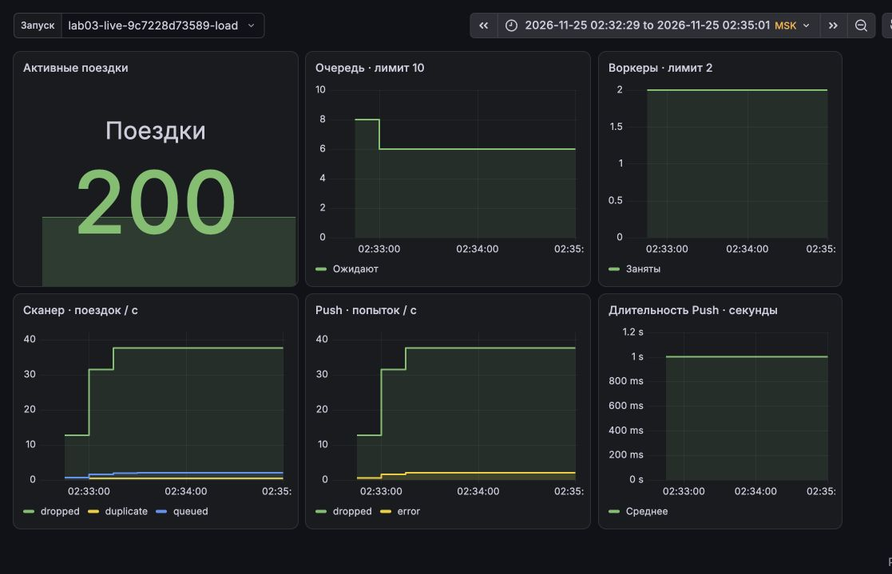

# ЛР3: проверка FIFO и опроса координат

Проверено 25 ноября 2026 года (Europe/Moscow) на настоящем окружении курса `tripgo-lab-03`: PostgreSQL, Push Service, OTel Collector, Prometheus, Grafana и Jaeger. Docker Desktop был запущен; существующий kind-кластер и его данные сохранены. Команды Git не выполнялись.

Для собственных фикстур создавались отдельные временные схемы в PostgreSQL этого окружения. Адреса БД, Push и OTLP брались из локального `.env`; содержимое и пароли в артефакты не включены. После проверок схемы удалены, задержка Push сброшена в `0`, запущенные для проверки процессы сервиса завершены. Окружение курса оставлено готовым к работе.

## Конфигурация измерения

Сервис собран с `-race`. Переопределения действовали только в окружении проверяемого процесса:

| Параметр | Значение |
|---|---|
| `POSITION_CHECK_INTERVAL` | `5s` |
| `POSITION_STALE_AFTER` | `10s` |
| `POSITION_WORKERS` | `2` |
| `POSITION_QUEUE_SIZE` | `10` |
| `PUSH_REQUEST_TIMEOUT` | `1s` |
| `SHUTDOWN_TIMEOUT` | `10s` |
| `OTEL_METRIC_EXPORT_INTERVAL` | `1000` мс |
| Push admin: `latency_ms` | `5000` в нагрузочной фазе, затем `0` |

Штатные значения приложения остаются `30s / 60s / 4 / 100 / 1s / 10s`. Интервалы сокращены для наблюдаемого проверочного прогона. Серии Prometheus отфильтрованы по `exported_instance`, чтобы не смешивать счётчики с предыдущими запусками.

## Результаты живого прогона

| Сценарий | Наблюдение |
|---|---|
| Молчащая поездка | 4 команды `REQUEST_POSITION`; интервалы 4,994, 5,004 и 4,995 с |
| Свежие координаты | 12 успешных записей, период обновления 2 с; 0 Push |
| Завершённая поездка | 0 Push |
| Переполнение | 200 активных поездок, очередь 10, 2 воркера; `stale_checks{dropped}` вырос до 5448 |
| Медленный Push | Задержка 5 с при таймауте 1 с; в наблюдаемой серии 282 ошибки, воркеры продолжали обработку |
| Лимиты | В экспортированных точках максимум 2 занятых воркера; размер очереди 0–8, не выше ёмкости 10 |
| Readiness под нагрузкой | Максимум 10,310 мс в длительном прогоне |
| GET поездки | 15 запросов при медленном Push, максимум 9,952 мс |
| GET маршрута | 15 запросов при медленном Push, максимум 9,598 мс |
| POST координаты | 15 запросов при медленном Push, максимум 13,824 мс |
| SIGTERM под длительной нагрузкой | Выход с кодом 0 за 3,685 с |
| SIGTERM в отдельной проверке бизнес-ручек | Выход с кодом 0 за 5,660 с при общем бюджете 10 с |
| Рестарт | Без прогрева повторно найдены сохранённые активные поездки; наблюдались 24 принятые команды, в БД оставались те же 200 активных поездок |

Длительная нагрузочная фаза длилась 151,42 с. RSS процесса составил 49,78–79,94 MiB, последнее измерение — 54,20 MiB. Это наблюдение за конечным прогоном; ограниченность очереди также проверена конкурентными тестами. Экспорт метрик дискретный: мгновенные переполнения подтверждаются `dropped` и `Warn`, даже если между экспортами часть буфера уже разобрана.

После возобновления Docker VM в первом замере временных меток был скачок часов. Этот замер интервалов отброшен; значения в таблице получены отдельным повторным прогоном после стабилизации часов.

## Метрики и трейсы



Снимок показывает интервал 25.11.2026 02:32:29–02:35:01 MSK для `lab03-live-9c7228d73589-load`. Счётчики `dropped` включены и в `tripgo.stale_checks`, и в `tripgo.position_requests`. Длительность неуспешных попыток — около настроенного таймаута 1 с.

Проверены реальные трейс и логи Push: `positions.request` имеет ссылку `FOLLOWS_FROM` на спан сканирования в другом trace, а отдельный клиентский `push.request_position` является его дочерним спаном. `request_id` передаётся в HTTP JSON и присутствует в логах заглушки. Подтверждение без лишних атрибутов процесса — [trace-summary.json](trace-summary.json).

[Дашборд для импорта](dashboard.json), [результаты сценариев](live-results.json), [сводка метрик](metrics-summary.json), [измерения памяти](memory-samples.json).

## EXPLAIN

6000 фикстур: 5950 завершённых поездок, 40 активных со свежей координатой и 10 активных без координат. Порог — 60 секунд. Выполнен `ANALYZE`, настройки планировщика принудительно не менялись.

```sql
EXPLAIN (ANALYZE, BUFFERS)
SELECT id, driver_id, COALESCE(last_position_at, started_at) AS last_activity
FROM trips
WHERE status = 'active'
  AND COALESCE(last_position_at, started_at) < now() - interval '60 seconds'
ORDER BY last_activity, id;
```

Текущий план — `Bitmap Index Scan on trips_active_position_age_idx` → `Bitmap Heap Scan` → `Sort`; выдано 10 строк, `Seq Scan` отсутствует. При перемешанном физическом порядке вставки время исполнения — 0,123 мс. План действительно использует созданный частичный индекс. Конкретный вид индексного доступа выбирает PostgreSQL по стоимости; обычный `Index Scan` не фиксируется кодом сервиса.

- [Текущий план, перемешанные фикстуры](explain.txt).
- [Текущий план, активные фикстуры рядом в таблице](explain-clustered.txt).
- [Ранее сохранённый обычный Index Scan на 6000 поездках](explain-previous.txt): выполнение 0,028 мс.

## Автоматические проверки

После оформления результатов повторно прошли:

- `go test -race -count=2 ./...` с покрытием и `goleak` в пакетах фоновых компонентов;
- `make test-integration` — PostgreSQL-репозитории и сквозной тест контейнера, два прогона с `-race`, на БД окружения курса;
- `golangci-lint run ./...` — 0 issues;
- форматирование новых Go-файлов.

Покрытие домена и всех пяти usecase — 100%; фоновых компонентов — 94,8%; Push-гейтвея — 95,7%. Добавлены unit-тесты чтения маршрута: пустой маршрут, точки, отсутствующая поездка и ошибки чтения.

В `make docker-run` добавлена подмена `localhost` в `PUSH_HTTP_URL` на `host.docker.internal`, как для БД и OTLP; проверено формирование команды на безопасных примерах. В `.env.example` адрес админки Push исправлен на тот же HTTP-порт. Полная повторная сборка Docker-образа в этот блок не входила.

Батчи, приоритетная очередь, ретраи и rate limiter в ЛР3 не реализованы.
